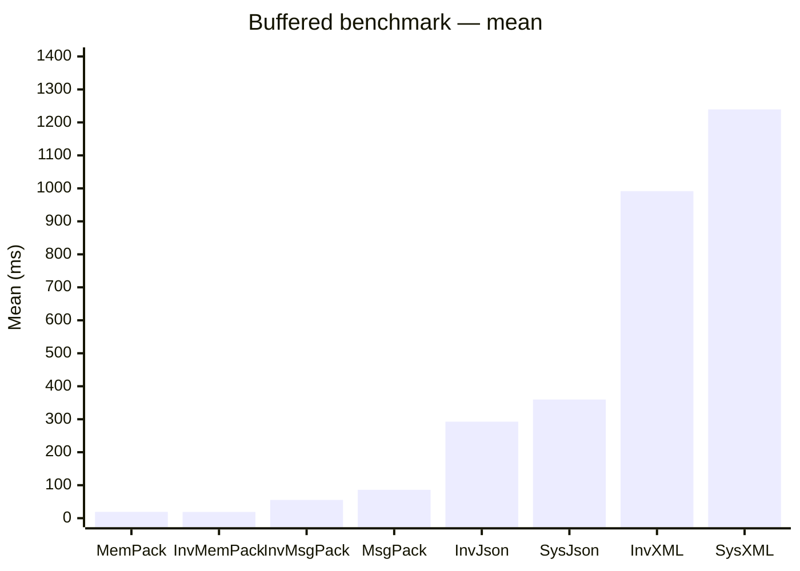
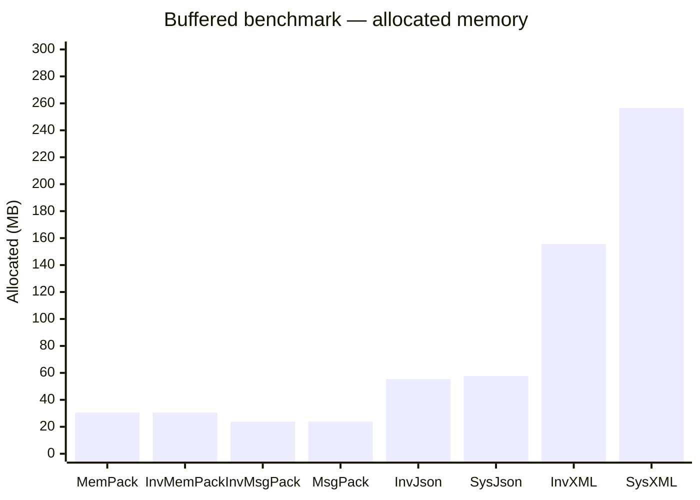
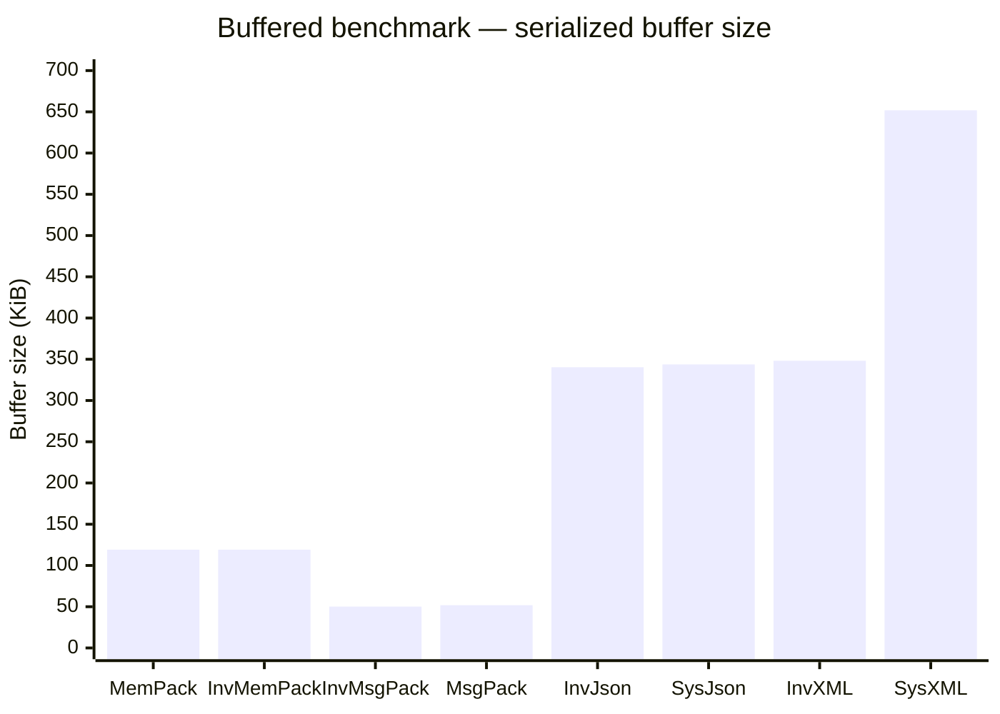

# DataWF.Serialization Benchmarks

BenchmarkDotNet benchmarks comparing DataWF's generated/invoker serializers with
the corresponding framework and third-party serializers. The benchmarks use a
generated `TestClass` object graph containing primitive, nullable, collection,
and nested values.

## Benchmark groups

- **Buffered** — serializes to an in-memory byte buffer and deserializes it
  again. Includes DataWF Invoke, System.Text.Json, DataContractSerializer, MemoryPack,
  and MessagePack paths.
- **Streammed** — serializes to a file stream and deserializes from it, using
  asynchronous APIs where available.

Both groups use 100 `TestClass` instances by default and perform 100
serialize/deserialize iterations per benchmark operation. The values are
configured in `Benchmarks/BaseSerializetion.cs`.

## Run

From this directory, run all benchmarks:

```sh
dotnet run -c Release
```

Run only the buffered or streaming group:

```sh
dotnet run -c Release -- --filter '*Buffered*'
dotnet run -c Release -- --filter '*Streammed*'
```

BenchmarkDotNet writes reports to `BenchmarkDotNet.Artifacts/results/`.

## Buffered benchmark results

The charts below are a snapshot of the medians, allocated memory, and serialized
buffer sizes in
[`BenchmarkDotNet.Artifacts/results/DataWF.Benchmark.Serialization.Buffered-report-github.md`](BenchmarkDotNet.Artifacts/results/DataWF.Benchmark.Serialization.Buffered-report-github.md).
Refresh the chart values from the report after rerunning the benchmarks.
Short x-axis labels map to benchmark methods as follows:

| Label | Benchmark method |
|---|---|
| InvMemPack | `InvokeMemoryPack` |
| InvMsgPack | `InvokeMessagePack` |
| InvJson | `InvokeJson` |
| InvXML | `InvokeXml` |
| MemPack | `MemoryPack` |
| MsgPack | `MessagePack` |
| SysJson | `SystemJson` |
| SysXML | `SystemXml` |

### Mean duration



### Allocated memory



### Serialized buffer size


